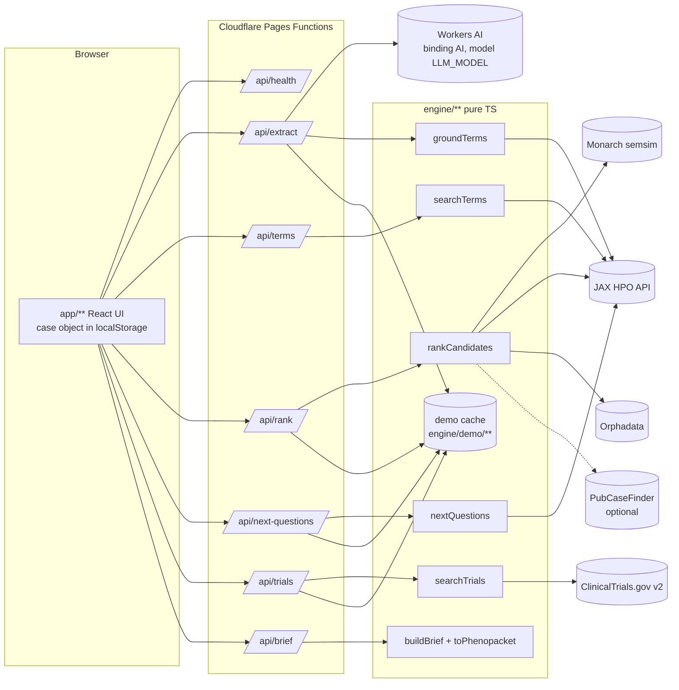
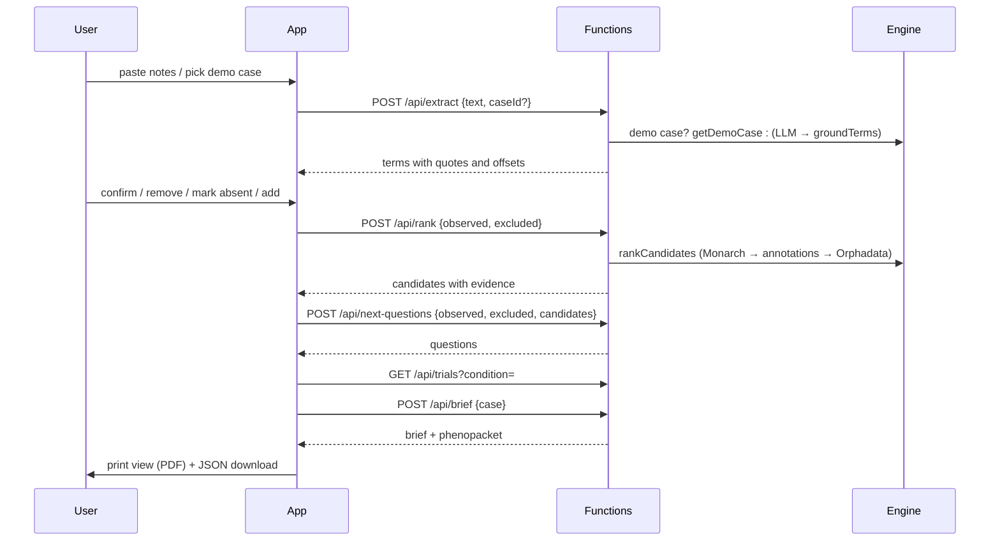

# Design: Rare Disease Detective

> Status: v0.1 DRAFT. Request and response shapes, types, engine signatures, error codes, timeouts and demo cases are defined in [`docs/CONTRACT.md`](../../../docs/CONTRACT.md) (v0.1). This design refers to contract sections instead of repeating them. Requirement numbers refer to `requirements.md`.

## Overview

Three layers, each with one owner:

- **App** (`app/**`, Ian): Vite + React + TypeScript under `/app`. Holds the case object in `localStorage`, calls only `/api/*`.
- **Pages Functions** (`functions/api/<name>.ts`, Ian): thin HTTP adapters. Validate input, call the engine with the real `fetch` and `caches.default`, map engine errors to the contract error shape. `extract.ts` also owns the LLM call: Cloudflare Workers AI through the Pages Functions AI binding `AI` (no API key), model id from `LLM_MODEL` with a default chosen in T17.
- **Engine** (`engine/**`, Jerry): repo-root TypeScript, Workers-compatible, pure functions with injected network. Grounding, ranking assembly, question selection, brief and phenopacket building, demo cache.

Design choice: the LLM is limited to proposing phrases and labels. Everything shown as a medical fact (term ids, disease names, frequencies, genes) comes from HPO, Monarch or Orphanet responses, so it can be traced and tested (Requirements 2.2, 9.3).

## Architecture

### Request flow (happy path)

## Components

### Engine (Jerry, `engine/**`)

| Module | Responsibility | Contract |
|---|---|---|
| `engine/types.ts` | Shared types, exported to functions and app | §5 |
| `engine/http.ts` | Fetch wrapper: timeout via `AbortSignal.timeout`, one retry on 5xx/network for GETs, JSON validation, Workers cache read/write, typed `UpstreamError` | §10 |
| `engine/hpo.ts` | HPO term lookup, search, disease annotations; `normalizeFrequency` | §6, §7.3 |
| `engine/ground.ts` | `groundTerms`: quote location, id confirmation, label re-mapping, dedupe | §7.2 |
| `engine/rank.ts` | `rankCandidates`, `overlapLabel`: Monarch call, id choice (ORPHA > OMIM > MONDO), evidence assembly, notReported, contradicted, ordering | §7.4 |
| `engine/questions.ts` | `nextQuestions`: discrimination score over annotations, template phrasing | §7.5 |
| `engine/trials.ts` | `searchTrials`: ClinicalTrials.gov query and mapping | §7.6 |
| `engine/brief.ts` | `buildBrief`, `toPhenopacket`, `specialistsFor` (pure) | §7.7 |
| `engine/data/specialists.ts` | Small documented organ-system → specialty table | §7.7, open question 4 |
| `engine/text.ts` | Disclaimer and attribution strings | §13 |
| `engine/demo/**` | Five demo cases (`demo-npc1` primary, then `demo-dmd`, `demo-marfan`, `demo-kabuki`, `demo-cdls`) and recorded responses, under 400 KB | §9 |
| `engine/index.ts` | Public exports | §6 |

### Functions (Ian, `functions/api/*`)

Each file exports `onRequestGet` or `onRequestPost`, parses and validates input (ids match `^HP:\d{7}$`, list sizes, text length), builds `EngineDeps` from `fetch`, `caches.default` and `Date`, and adds `version` and `source`. A shared `functions/_lib/` helper for JSON responses and error mapping is a separate Ian claim if needed.

### App (Ian, `app/**`)

Feature folders, each claimed separately:

| Folder | Screens / parts | Requirements |
|---|---|---|
| `app/src/features/intake/` | Notes input, demo picker, character count | 1, 10 |
| `app/src/features/review/` | Term list with quotes and highlights, status controls, manual add | 2 |
| `app/src/features/ranking/` | Candidate list, evidence panel, data sources, re-rank state | 3, 4 |
| `app/src/features/questions/` | What to check next, yes/no answers | 5 |
| `app/src/features/trials/` | Recruiting studies per candidate | 7 |
| `app/src/features/brief/` | Print view, phenopacket download | 6 |
| `app/src/shared/` | API client, case store, disclaimer, footer attribution, state components (loading, empty, error, offline) | 8, 9, 11, 12 |

### Landing (Peter, `landing/**`)

Shares tokens, type, accent and voice with the app. Hero shows the real proof moment (a true screenshot of evidence lining up behind a ranked candidate). Main call to action opens `/app/?demo=demo-npc1` with the primary demo case preloaded (Requirement 10.6).

## Data models

All in contract §5 (types) and §8 (case object). Key points:

- `ExtractedTerm` carries `quote`, `start`, `end`; the app highlights `notes.slice(start, end)`.
- `Candidate` carries `matched`, `unmatched`, `notReported`, `contradicted`, `genes`, `categories`, `links`, `sources`; the evidence panel is a direct rendering of these fields.
- `FrequencyInfo` keeps both the HPO band and the raw value so the UI can show "Very frequent (112/140)".
- `CaseObject` is versioned (`version: "0.1"`) so a stored case from an older contract can be detected and reset.

## Engine approach

1. **Grounding.** The LLM output is untrusted input. Exact-substring search sets offsets; ids are confirmed by the HPO term endpoint; labels that disagree trigger a label search; anything unconfirmed is dropped with a warning. The HPO primary name replaces the LLM's wording.
2. **Ranking.** Monarch semsim (`ancestor_information_content`) is the only ranker in v0.1. The engine adds evidence on top: per-feature frequencies and genes from JAX HPO annotations (ORPHA and OMIM both fetched, because ORPHA gives frequency bands and OMIM gives genes, verified 2026-10-24), and an Orphadata name check. Input ids are sorted and deduplicated before any call, so output and cache key do not depend on order.
3. **Overlap label.** `overlapLabel(matched, observed, contradicted)` turns coverage into strong / partial / weak and lowers it one step per contradicted feature. It is monotone by construction, which makes Requirement 4.4 testable.
4. **What to check next.** Discrimination score = spread of frequency midpoints across the top candidates (Köhler 2009 idea), excluding already observed or excluded terms. Questions use a fixed template.
5. **Brief and phenopacket.** Pure functions of the case object. Specialists and tests appear only when traceable to the mapping table or to annotated genes.
6. **Demo cache.** Recorded responses keyed by `demoRankKey(sorted observed, sorted excluded, limit)`. Used for demo-case extraction always, and for ranking, questions and trials only as a fallback on upstream failure.

## Error handling

| Layer | Behaviour |
|---|---|
| Engine | Throws typed errors: `UpstreamTimeout(name)`, `UpstreamError(name, status)`, `InvalidInput(field)`. Secondary sources (Orphadata, PubCaseFinder, a single annotation call) are caught inside the engine and only remove their data. |
| Functions | Map `InvalidInput` → 400, `UpstreamTimeout` → 504, `UpstreamError` → 502 (429 passes through as `RATE_LIMITED`), missing `AI` binding → 503 `LLM_UNAVAILABLE`, Workers AI timeout → 504, Workers AI error → 502, other → 500 `INTERNAL`. Before returning 502/504, try the demo cache. Never include note text or stack traces in messages or logs. |
| App | Every error keeps the case. `retryable: true` shows "Try again"; `false` shows the next possible action (demo case, manual add, shorten text). Offline detection via `navigator.onLine` and failed fetch. Loading states are skeletons at final size with the real step name. |

## Testing strategy

| Level | Owner | Where | What |
|---|---|---|---|
| Unit | Jerry | `engine/test/**` (Vitest or `node:test`, Jerry's choice) | Each engine module with recorded upstream JSON fixtures and a mock `fetch`; frequency normalisation; id choice; error mapping |
| Property-based | Jerry | `engine/test/**` with fast-check | Properties P1–P14 (below and contract §11) |
| Function | Ian | next to functions or `functions/test/**` (separate claim) | Input validation, error shape and status codes, demo fallback, using a stub engine |
| End-to-end smoke | Ian | `scripts/` smoke (T03 path) | On local `wrangler pages dev` and on the live URL: health, extract demo case, rank, next-questions, trials, brief; asserts `version`, `source`, and shapes. Live upstream run and forced-failure run (bad upstream host via env) |
| Manual UI | Ian | screenshots | Design steering §12 definition of done (sizes, keyboard path, reduced motion, contrast, states) |
| Benchmark | Jerry | `engine/bench/**` | Top-1/5/10 recall on 50 phenopacket-store cases, labelled as our own evaluation (contract §12) |

## Correctness properties

Each property maps to requirements; full wording and function names are in contract §11.

| # | Property | Requirements |
|---|---|---|
| P1 | Grounding never returns an HPO id the mocked HPO lookup did not confirm | 2.2, 9.3 |
| P2 | Every quote equals `text.slice(start, end)`; offsets in range; label is the HPO primary name | 2.3 |
| P3 | No duplicate `hpoId` in an extraction | 2.1 |
| P4 | Ranking is deterministic and independent of input order and duplicates | 3.6 |
| P5 | Ranks are 1..n without gaps; n ≤ limit; order by score then id | 3.3 |
| P6 | matched + unmatched covers every observed term once | 3.4 |
| P7 | Excluding a feature a disease usually has never improves its overlap label | 4.4 |
| P8 | `overlapLabel` is monotone | 3.5, 4.4 |
| P9 | Questions never contain observed or excluded terms; one `discriminates` entry per candidate | 5.3, 5.4 |
| P10 | Phenopacket always has the required fields and schema version "2.0" | 6.4 |
| P11 | Phenopacket round-trips observed/excluded flags; removed terms never appear | 6.4 |
| P12 | Frequency normalisation matches the HPO bands | 3.4, 3.7 |
| P13 | Brief specialists and tests are traceable to the mapping table or annotated genes | 6.3, 9.3 |
| P14 | Demo extractions satisfy P2 and have at least 6 observed terms | 10.1 |

## Open design points

Tracked in contract §15 (LLM provider is decided: Workers AI binding `AI`): ORPHA vs OMIM primary id, PubCaseFinder, specialist table, demo cache size, HPO version source, ancestor-aware contradictions, overlap thresholds, `/api/terms`.
